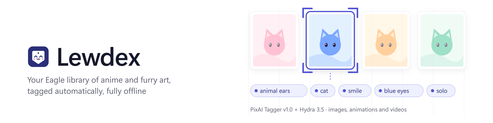

<picture>
  <source media="(prefers-color-scheme: dark)" srcset="docs/banner-dark.png">
  
</picture>

  
  
  
  
  

Lewdex tags your [Eagle 4](https://eagle.cool) library automatically. It looks at every image,
animation and video, and writes descriptive tags (characters, series, art style, clothing,
colours, species...) straight into Eagle. Made for large art and illustration collections:
anime, cartoon and furry art.

It uses two AI taggers, **PixAI Tagger v1.0** and **Hydra 3.5**, and runs entirely on your PC:
nothing is uploaded anywhere.

> Lewdex is an independent project and is not affiliated with or endorsed by Eagle (ogdesign).

## Requirements

* Windows 10 or 11
* An NVIDIA graphics card with a recent driver (R580 or newer) and about 6 GB of video memory.
  Without one Lewdex still works, but very slowly.
* Eagle 4
* About 10 GB of free disk space and an internet connection for the first install

## Install

1. Download `Lewdex-<version>.zip` from the
   [Releases](https://github.com/edlmar/Lewdex/releases) page.
2. Unpack it to a folder whose path has no spaces or non-Latin letters, e.g. `C:\Lewdex`.
3. Double-click `Install.cmd`. It downloads everything Lewdex needs (about 8 GB), checks your
   graphics card and Eagle, and adds a **Lewdex** shortcut to the Desktop and the Start menu.

Then open Lewdex from the Desktop or the Start menu. After the installation it works offline.

If the installation stops with an error, check the internet connection and run `Install.cmd`
again - it continues where it stopped. Running it again later also repairs the installation.

**To uninstall**, delete the Lewdex folder and the two shortcuts. The tags already written stay in
Eagle.

## Use

1. Start Eagle with the library you want to tag.
2. Open Lewdex and press **Start**.

Lewdex goes through the whole library, videos and animations included. The window follows the
Windows light or dark theme and shows the progress, files per second, time left, the graphics
card's load and a log. The progress also shows on the Lewdex button in the taskbar, and Windows
shows a notification when a run ends while the window is in the background.

* **Pause** holds the work; **Stop** finishes the current step and ends the run.
* Closing the window during a run asks first, then stops the run safely.
* Pressing **Start** again continues where it left off; files already processed are not
  analysed again.
* When a run ends, the window tells what it did. If some files could not be written to Eagle
  (for example because Eagle was closed), **Retry these files** writes just those.
* The first start takes a minute longer while Lewdex prepares the taggers.

## Your existing tags

**By default Lewdex replaces the tags of every file it processes** with the new ones. Your old
tags are not lost: they are saved first and can be put back.

Both are in **Settings** (the button next to **Start**):

* **Your existing tags**: replace them, keep them and only add new tags, or keep your own tags
  and replace only the tags Lewdex added earlier.
* **Put back old tags**: choose a run and press **Put back…**; the tags that run removed are
  added back (tags added since stay).

## Settings

What to do with existing tags, the taggers and the graphics card are chosen in **Settings** in
the window. Everything else is in `lewdex.toml` in the Lewdex folder (**Settings > Open
lewdex.toml**); the file explains each option. The most useful ones:

| setting | default | meaning |
|---|---|---|
| `write.mode` | `replace` | `replace` the tags, only `add` new ones, or `sync` (remove only tags Lewdex added itself) |
| `models.pixai.thresholds` | 0.15–0.41 | how sure the tagger must be before it writes a tag: higher means fewer, surer tags |
| `models.pixai.categories` | general, character, copyright, style | which kinds of tags are written |
| `video.max_frames` | 8 | frames looked at per video or animation |
| `merge.blacklist` | | tags that are never written |

Changed thresholds, categories or the blacklist apply on the next **Start** without analysing
the files again.

## Troubleshooting

* **Eagle is not reachable**: start Eagle 4 and open your library, then press Start again.
* **The graphics card is not used / CUDA is not available**: update the NVIDIA driver and
  restart the PC.
* When reporting a problem, please attach `logs\lewdex.jsonl` from the Lewdex folder.

## License

[Apache License 2.0](LICENSE). © 2026 Edgars Edelmers. Lewdex downloads and uses:

| Component | License |
|---|---|
| [PixAI Tagger v1.0](https://huggingface.co/pixai-labs/pixai-tagger-v1.0) (PixAI Labs; includes code adapted from Meta's SAM 3) | Apache-2.0 |
| [Hydra 3.5](https://huggingface.co/RedRocket/Hydra) (Project RedRocket) | Apache-2.0 |
| [anime/real photo classifier](https://huggingface.co/deepghs/anime_real_cls) (deepghs) | OpenRAIL |

The tag synonym table is derived from RedRocket's alias list shipped with Hydra and from the
public tag-alias data of e621 and Danbooru.

Eagle is a product of ogdesign; Lewdex is not affiliated with or endorsed by it.

## Contact

Edgars Edelmers – edgars.edelmers@disroot.org, or open an [issue](https://github.com/edlmar/Lewdex/issues).
